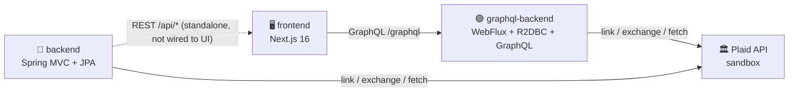

# 🏦 ToyotaFSBank — Banking Hub

<p>
  
  
  
  
  
</p>

A banking dashboard with **Plaid Link** wired in to connect external bank accounts and aggregate balances/transactions. The repo ships **two independent backends** exposing the same feature set over different APIs/styles, plus a frontend that talks to one of them.

> 🔀 **Two backends, one UI.** Compare a classic **REST + blocking JPA** stack against a **GraphQL + reactive WebFlux/R2DBC** stack side by side — same domain, same Plaid integration, different architecture.

---

## 📑 Table of contents

- [Architecture](#-architecture)
- [Project structure](#-project-structure)
- [REST backend](#-rest-backend-toyotafsbankbackend)
- [GraphQL backend](#-graphql-backend-toyotafsbankgraphql-backend)
- [Frontend](#-frontend-toyotafsbankfrontend)
- [Plaid credentials](#-plaid-credentials-both-backends)
- [Verified end-to-end](#-verified-end-to-end-both-backends)

---

## 🧭 Architecture



The frontend talks to **`graphql-backend/`** — `backend/` still runs standalone and is fully functional over REST, it's just not what the UI is wired to today.

## 📂 Project structure

```
banking_hub/
└── ToyotaFSBank/
    ├── backend/          🔵 Spring Boot 4.1.2 (Java 21, Maven) — REST, blocking (JPA)
    ├── graphql-backend/  🟢 Spring Boot 3.3.5 (Java 21, Maven) — GraphQL, reactive (WebFlux + R2DBC)
    └── frontend/         🖥️ Next.js 16 (TypeScript, Tailwind, App Router) — Banking Hub UI
```

Both backends implement the same two features — your ToyotaFSBank accounts, and Plaid account-linking/aggregation — so you can compare the two stacks directly.

---

## 🔵 REST backend (`ToyotaFSBank/backend/`)

| | |
|---|---|
| **Stack** | Java 21 · Spring Boot 4.1.2 · Maven · blocking Spring MVC · Spring Data JPA |
| **Port** | `8081` (8080 was already taken on this machine) |
| **DB console** | [`http://localhost:8081/h2-console`](http://localhost:8081/h2-console) — JDBC URL `jdbc:h2:mem:toyotafsbankdb`, user `sa`, no password |

- `Account` — your ToyotaFSBank-held accounts, full CRUD at `/api/accounts`
- `plaid/` — creates Plaid Link tokens, exchanges public tokens for access tokens (stored server-side only), fetches balances/transactions

| Method | Path | Description |
|:---:|---|---|
| `GET` | `/api/health` | Service health |
| `GET`/`POST`/`PUT`/`DELETE` | `/api/accounts[/{id}]` | ToyotaFSBank account CRUD |
| `POST` | `/api/plaid/link-token` | Create a Plaid Link token |
| `POST` | `/api/plaid/exchange-token` | Exchange a public token after Link |
| `GET` | `/api/plaid/items` | List linked institutions |
| `GET` | `/api/plaid/accounts` | Live balances across all linked accounts |
| `GET` | `/api/plaid/transactions` | Combined transaction feed |
| `DELETE` | `/api/plaid/items/{itemId}` | Unlink an institution |

```bash
cd ToyotaFSBank/backend && ./start.sh   # loads .env for Plaid credentials, then spring-boot:run
```

---

## 🟢 GraphQL backend (`ToyotaFSBank/graphql-backend/`)

Same two features (accounts + Plaid), reimplemented reactive/GraphQL-style, following the conventions of the `spring-graphql-app` reference project (permissive-by-default security with an opt-in `secure` JWT profile, reactive CORS config, `@QueryMapping`/`@MutationMapping` controllers, R2DBC repositories).

| | |
|---|---|
| **Stack** | Java 21 · Spring Boot 3.3.5 · Maven · Spring WebFlux + Spring for GraphQL (reactive) · R2DBC (H2) |
| **Port** | `8082` |
| **Playground** | [`http://localhost:8082/graphiql`](http://localhost:8082/graphiql) |
| **Schema** | `src/main/resources/graphql/schema.graphqls` |

> ⚙️ The Plaid Java SDK is **blocking** (no reactive client exists) — every Plaid call is wrapped in `Mono.fromCallable(...).subscribeOn(Schedulers.boundedElastic())` in `PlaidService`, so blocking HTTP calls never tie up Netty's event loop while the API surface stays fully `Mono`/`Flux`.

> 🔐 Security is permissive by default (matches `backend/`'s no-auth posture). Set `SPRING_PROFILES_ACTIVE=secure` + `OAUTH_ISSUER_URI` to require a real JWT instead.

<details>
<summary><strong>📜 GraphQL schema (click to expand)</strong></summary>

```graphql
type Query {
  accounts: [Account!]!
  account(id: ID!): Account
  plaidItems: [PlaidItem!]!
  plaidAccounts: [PlaidAccount!]!
  plaidTransactions: [PlaidTransaction!]!
}

type Mutation {
  createAccount(input: AccountInput!): Account!
  updateAccount(id: ID!, input: AccountInput!): Account!
  deleteAccount(id: ID!): Boolean!
  createPlaidLinkToken: String!
  exchangePlaidPublicToken(input: ExchangePublicTokenInput!): PlaidItem!
  unlinkPlaidItem(itemId: ID!): Boolean!
}
```

</details>

```bash
cd ToyotaFSBank/graphql-backend && ./start.sh
```

---

## 🖥️ Frontend (`ToyotaFSBank/frontend/`)

| | |
|---|---|
| **Stack** | Next.js 16 · TypeScript · Tailwind CSS · App Router · `react-plaid-link` |
| **Port** | `3002` — points at the **GraphQL** backend (`NEXT_PUBLIC_API_URL=http://localhost:8082` in `.env.local`) |

- `src/lib/api.ts` — a small `graphql()` fetch helper (POSTs `{ query, variables }` to `/graphql`, throws on the `errors` array) backing every data call; no GraphQL client library needed for this app's size. Health check pings the backend's own `/actuator/health` directly (not part of the GraphQL schema).
- `src/components/BankingHubDashboard.tsx` — net worth summary, linked institutions with live balances, ToyotaFSBank accounts, searchable transaction feed

```bash
cd ToyotaFSBank/frontend && npm run dev   # then open http://localhost:3002
```

🔁 To point the UI back at the REST backend instead, change `NEXT_PUBLIC_API_URL` to `http://localhost:8081` and swap `src/lib/api.ts` back to REST calls (the GraphQL version is a straight swap of the function bodies, not the signatures).

---

## 🔑 Plaid credentials (both backends)

Each backend has its own `.env` (gitignored) + `.env.example`, loaded by its own `start.sh` — same convention as `plaid/quickstart`:

```bash
PLAID_CLIENT_ID=...
PLAID_SECRET=...
PLAID_ENV=sandbox
PLAID_PRODUCTS=transactions
PLAID_COUNTRY_CODES=US
```

Get sandbox credentials at [dashboard.plaid.com/developers/keys](https://dashboard.plaid.com/developers/keys). Both backends are already configured with sandbox credentials locally and verified working.

---

## ✅ Verified end-to-end (both backends)

For each backend, with real sandbox credentials, no mocking:

1. ✅ Booted and passed a context-load test (REST: full Spring context; GraphQL: schema inspection reported zero unmapped fields/arguments)
2. ✅ `createAccount`/`accounts` (REST: `POST`/`GET /api/accounts`; GraphQL: mutation/query) — confirmed persistence
3. ✅ Created a **real** Plaid Link token against Plaid's actual sandbox API
4. ✅ Used Plaid's sandbox-only `/sandbox/public_token/create` shortcut to simulate a completed Link session for "First Platypus Bank" (`ins_109508`) without a browser, then exchanged it through each backend's own exchange endpoint/mutation
5. ✅ Fetched the **real** 15 sandbox accounts and 48 sandbox transactions back through each backend (confirmed via an established TCP connection from the backend's own process to Plaid's sandbox IP during the request)
6. ✅ Unlinked the item and confirmed Plaid's `/item/remove` was called and local state cleared
7. ✅ Verified GraphQL error classification (`NOT_FOUND` for a missing account) and CORS preflight for both backends

🧹 Both backends were stopped after verification — nothing is left running.
