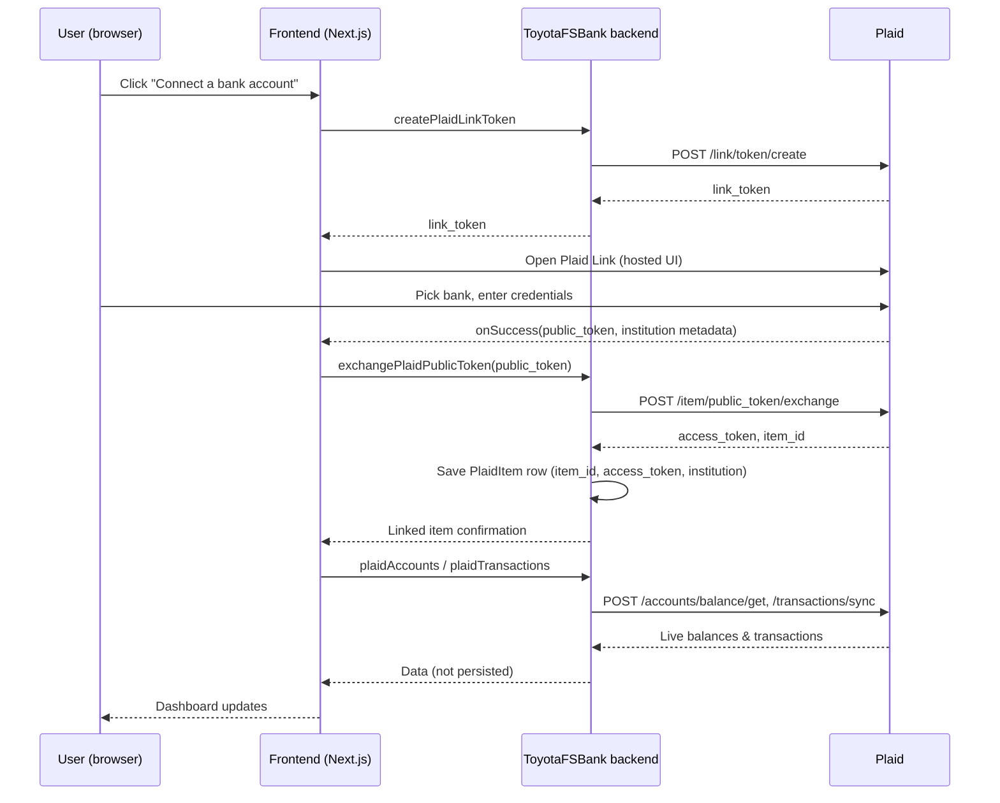

# Plaid Integration — How It Works

This document explains how ToyotaFSBank integrates with Plaid, step by step
from the moment the app loads to the moment account data shows up on the
dashboard — and exactly what does and doesn't get persisted along the way.

> **Note on "login":** ToyotaFSBank currently has **no user authentication**.
> There's no sign-up/login screen, no session, and no `User` table. Everything
> below starts from "the user opens the dashboard," not "the user logs in."
> Where this matters (mainly: linked accounts aren't scoped to anyone), it's
> called out explicitly in [Current limitations](#current-limitations).

## At a glance

```
┌─────────────┐        ┌──────────────────────┐        ┌───────────────┐
│   Browser    │        │   ToyotaFSBank        │        │     Plaid      │
│ (Next.js UI) │◄──────►│   backend (REST or     │◄──────►│  (sandbox or   │
│              │        │   GraphQL)             │        │   production)  │
└─────────────┘        └──────────────────────┘        └───────────────┘
                                   │
                                   ▼
                          ┌─────────────────┐
                          │  H2 database     │
                          │  (plaid_items     │
                          │   table only)      │
                          └─────────────────┘
```

Two backends implement the identical flow described here:

| | REST backend (`backend/`) | GraphQL backend (`graphql-backend/`) |
|---|---|---|
| Style | Spring MVC, blocking | Spring WebFlux + Spring for GraphQL, reactive |
| Port | 8081 | 8082 (the one the frontend currently talks to) |
| Data access | Spring Data JPA | Spring Data R2DBC |
| Plaid calls | Direct blocking calls | Wrapped in `Mono.fromCallable(...).subscribeOn(Schedulers.boundedElastic())` — the Plaid Java SDK is blocking-only, so this keeps it off Netty's event loop |

## The credentials

Both backends read Plaid credentials from environment variables (never
hardcoded, never committed — each has its own gitignored `.env`):

```bash
PLAID_CLIENT_ID=...
PLAID_SECRET=...
PLAID_ENV=sandbox            # or "production"
PLAID_PRODUCTS=transactions
PLAID_COUNTRY_CODES=US
```

Each backend's `start.sh` loads its `.env` into the process environment
before running `spring-boot:run` — same convention as the Plaid quickstart
app this was modeled on. `PlaidClientConfig` reads those into a `PlaidApi`
client pointed at Plaid's sandbox or production base URL.

## Step by step: linking a bank account

1. **User clicks "Connect a bank account" / "Add account"** in the dashboard.
2. **Frontend asks our backend for a Link token** — `createPlaidLinkToken`
   (GraphQL mutation) or `POST /api/plaid/link-token` (REST). The backend
   calls Plaid's `/link/token/create` with our `client_id`/`secret` and gets
   back a short-lived `link_token`. **Nothing is stored yet.**
3. **Frontend opens Plaid Link** (`react-plaid-link`'s `usePlaidLink` hook)
   using that token. Plaid renders its own hosted UI (an iframe) where the
   user picks their bank and enters credentials — ToyotaFSBank never sees
   those credentials; they go straight to Plaid.
4. **Plaid Link succeeds** and calls our frontend's `onSuccess` callback with
   a `public_token` (short-lived, single-use) plus metadata (institution
   name/id). **Still nothing stored** — a public token is not a usable
   credential on its own.
5. **Frontend sends that public token to our backend** —
   `exchangePlaidPublicToken` (GraphQL) or `POST /api/plaid/exchange-token`
   (REST). The backend calls Plaid's `/item/public_token/exchange`, which
   trades the public token for a long-lived `access_token` + an `item_id`
   (Plaid's identifier for this particular bank connection).
6. **This is the only point anything is written to our database** — one row
   in `plaid_items`:

   | Column | What it is |
   |---|---|
   | `item_id` | Plaid's identifier for this linked institution |
   | `access_token` | The credential used for every future call about this item |
   | `institution_id` / `institution_name` | From the Link UI's metadata |
   | `linked_at` | Timestamp set by our backend |

7. **Dashboard refetches.** `plaidAccounts` and `plaidTransactions` each loop
   over every row in `plaid_items` and call Plaid live —
   `/accounts/balance/get` and `/transactions/sync` respectively — using the
   stored `access_token`. The results are returned straight to the frontend
   and **never cached or written to our database.**



## Unlinking

`unlinkPlaidItem` / `DELETE /api/plaid/items/{itemId}` calls Plaid's
`/item/remove` (revoking the access token on Plaid's side) and then deletes
the corresponding `plaid_items` row. There's no "soft delete" — the row is
gone.

## What's stored vs. what's fetched live

| Data | Persisted in our DB? | Source |
|---|---|---|
| `access_token`, `item_id`, institution name/id | ✅ Yes — `plaid_items` table | Set once, at exchange time |
| Account list & balances | ❌ No | Fetched live on every `plaidAccounts` call |
| Transactions | ❌ No | Fetched live on every `plaidTransactions` call |
| Bank login credentials | ❌ Never seen by us at all | Entered directly into Plaid's hosted UI |
| Any user identity | ❌ No `User` table exists | N/A — see limitations below |

## Current limitations

These are things a production version of this feature would need to
address — called out here so they're not mistaken for oversights discovered
later:

- **No user scoping.** Every row in `plaid_items` is globally visible to
  anyone hitting the API — there's no `User` table and no `user_id` column
  on `plaid_items`. A real multi-user app needs both, plus a login/session
  layer to know *whose* request this is.
- **Access tokens are stored in plaintext**, in an in-memory H2 database.
  Fine for local/sandbox development; a real deployment needs the token
  encrypted at rest and a durable (not in-memory) database.
- **No webhook handling.** Plaid can push updates (new transactions, item
  errors, etc.) via webhooks; this app only ever pulls data synchronously
  when the dashboard asks for it.
- **`transactionsSync` re-fetches from a null cursor every time** rather
  than storing and resuming from Plaid's `next_cursor`. Fine at sandbox data
  volumes; would be inefficient at scale.

## Where to look in the code

| What | REST backend | GraphQL backend |
|---|---|---|
| Plaid client setup | `backend/.../plaid/config/PlaidClientConfig.java` | `graphql-backend/.../config/PlaidClientConfig.java` |
| Core logic | `backend/.../plaid/service/PlaidService.java` | `graphql-backend/.../service/PlaidService.java` |
| HTTP/GraphQL surface | `backend/.../plaid/controller/PlaidController.java` | `graphql-backend/.../graphql/PlaidController.java` |
| Stored entity | `backend/.../plaid/model/PlaidItem.java` | `graphql-backend/.../domain/PlaidItem.java` |
| Frontend trigger | `frontend/src/components/PlaidLinkButton.tsx` | (same — frontend is shared) |
